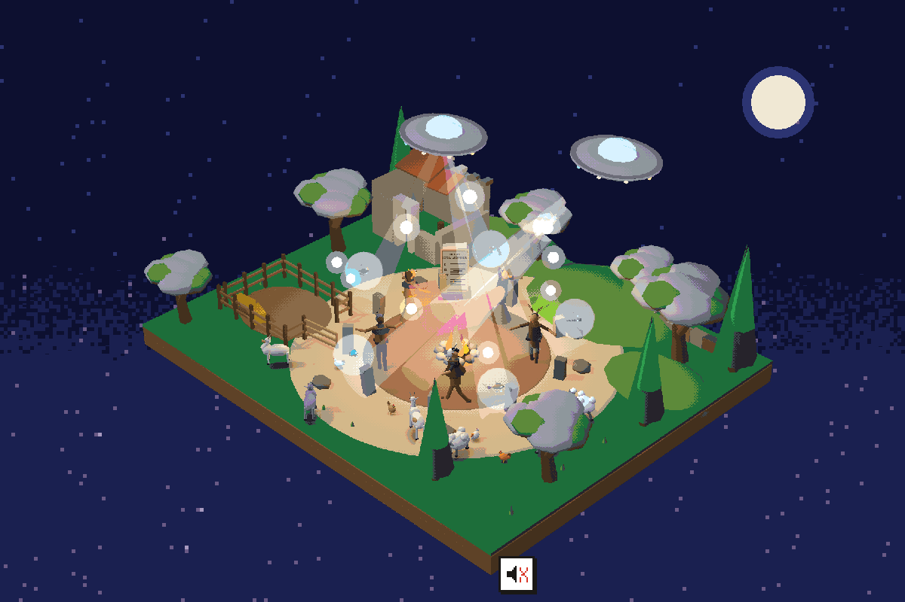

# El Culto de la Cabra

Diorama pixel-art 3D de una escena del cuento «Cero»: el Culto de la Cabra, en una colina de Perugia a fines del siglo XIII. Francisco y sus amigos (Marco, Idea, Axa y León) leen el Edictum Cetera Animalitas, se ponen máscaras de animales, abren el corral y bailan alrededor del fuego. Esferas de luz y discos metálicos bajan del cielo con criaturas encapsuladas en agua, aparece el pequeño dragón de las visiones y los animales ascienden en el Arrebatamiento.

- Three.js + esbuild, paleta de 64 colores, cámara fija, todo es función pura del tiempo; bucle de 90 s.
- `?t=<segundos>` congela un instante; `?from=<segundos>` arranca desde ahí. Sonido de 8 bits, silenciado al inicio.
- Build: `node build.mjs [--minify]` → `culto-de-la-cabra.html` autocontenido (copiar a `index.html` para publicar).

